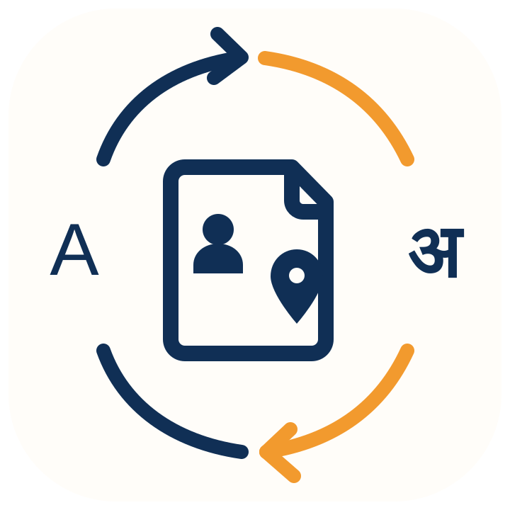
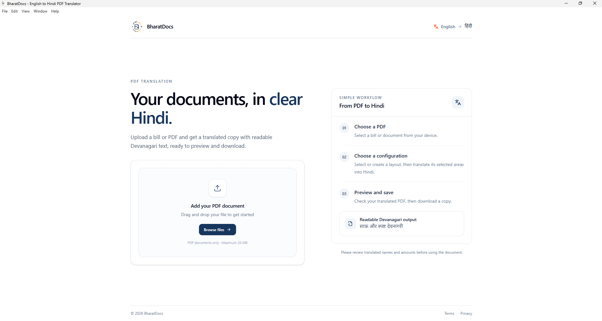
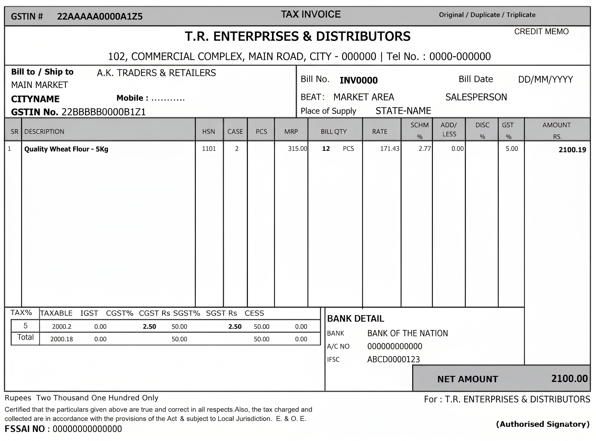
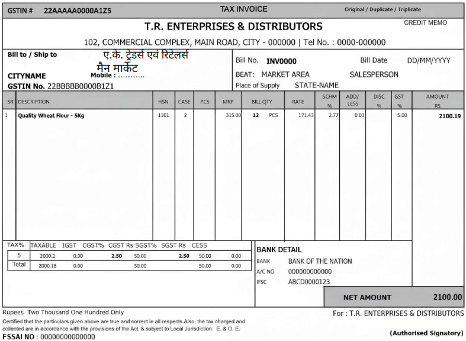
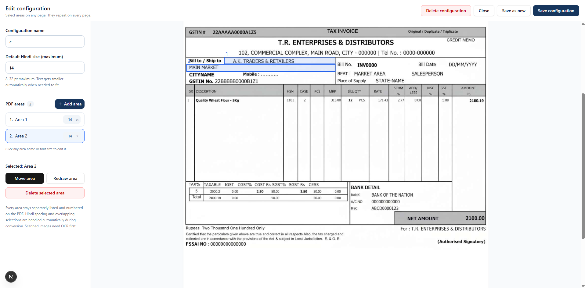

<div align="center">



# BharatDocs

### Your documents, in clear Hindi.

Convert selected English names, addresses, and invoice fields into readable Devanagari.<br />
Save your layouts. Keep your document structure. Work offline on Windows.

[](https://github.com/mitulkhemani2005/BharatDocs/releases/tag/v2.0.1)
[](https://github.com/mitulkhemani2005/BharatDocs/releases/download/v2.0.1/BharatDocs-Setup-2.0.1.exe)
[](https://github.com/mitulkhemani2005/BharatDocs/actions/workflows/ci.yml)

**[Download Windows app](https://github.com/mitulkhemani2005/BharatDocs/releases/download/v2.0.1/BharatDocs-Setup-2.0.1.exe)** · **[Release notes & checksum](https://github.com/mitulkhemani2005/BharatDocs/releases/tag/v2.0.1)** · **[Run the website](#run-the-website-locally)**

[See the result](#english-in-hindi-out) · [How to use](#three-steps-to-a-hindi-pdf) · [Configurations](#make-a-layout-once-reuse-it) · [Developer guide](#developer-guide) · [Troubleshooting](#troubleshooting)

</div>



## English in. Hindi out.

Choose exactly which fields to convert. This example converts the customer name and market address while retaining the rest of the invoice.

<table>
  <tr>
    <th width="50%">Original English invoice</th>
    <th width="50%">Hindi in the selected fields</th>
  </tr>
  <tr>
    <td><a href="docs/images/invoice-before.png"></a></td>
    <td><a href="docs/images/invoice-after.png"></a></td>
  </tr>
</table>

*Click either picture to view the full-size example.*

## Built for everyday bill processing

| Capability | What it does |
| --- | --- |
| **Selected-area conversion** | Converts the fields you mark and keeps Hindi inside those rectangles. |
| **Reusable configurations** | Save, edit, copy, or delete layouts for different invoice formats. |
| **Readable Hindi** | Uses bundled Noto Sans Devanagari Regular with shaped matras and automatic spacing. |
| **Automatic text fitting** | Wraps and reduces text size when needed, using your chosen size as the maximum. |
| **Offline OCR fallback** | Uses selectable text first; reads a selected scanned image area only when it has no selectable text. |
| **Multi-page processing** | Repeats the selected layout across all pages, scaling coordinates to each page size. |
| **Offline Windows app** | Includes the translation model, OCR data, font, and local backend in the installer. |
| **Separate website** | Runs a Next.js frontend and FastAPI backend independently of the desktop app. |

The conversion combines a Hindi glossary with IndicXlit spelling for names and addresses. It is designed for document fields; review converted names and amounts before using the output.

## Get the Windows app

1. **[Download BharatDocs 2.0.1](https://github.com/mitulkhemani2005/BharatDocs/releases/download/v2.0.1/BharatDocs-Setup-2.0.1.exe)** for Windows x64.
2. Run the installer and choose the installation folder.
3. Open **BharatDocs** from the Desktop or Start Menu shortcut.

The installed app processes documents locally and works without internet access. The target computer does not need Python, Node.js, or a separate Tesseract installation. A SHA-256 checksum is available on the [release page](https://github.com/mitulkhemani2005/BharatDocs/releases/tag/v2.0.1).

## Three steps to a Hindi PDF

| 1 · Add a PDF | 2 · Choose a configuration | 3 · Translate and save |
| --- | --- | --- |
| Browse or drag a document into the app. | Select a saved layout or create one using the uploaded PDF. | Click **Translate PDF into Hindi**, preview the result, and download it. |

**Supported uploads:** unencrypted PDF files up to **20 MB** and **200 pages**. Scanned PDFs use the automatic OCR fallback; recognition quality depends on the clarity of the scan.

## Make a layout once. Reuse it.



*The editor screenshot shows the selection workflow. In version 2.0.1, scanned selections are read automatically through offline OCR fallback.*

1. Upload a PDF, then click **New configuration** and enter a name.
2. Choose any page and draw a rectangle around an English field. Use **Add area** for more fields.
3. Rename areas directly in the list. Select **Move area** to reposition a rectangle or **Redraw area** to change its size.
4. Click an area's font-size badge to edit its maximum size. Use the reset icon, when shown, to return to the configuration default.
5. Click **Save configuration**. Choose it on the main screen and translate.

Use **Edit / delete** to reopen a saved layout, **Save as new** to copy it, or **Delete configuration** in the editor header to remove it. **Delete selected area** removes only the selected rectangle. The app starts with an empty configuration list so you can create layouts for your own documents.

### How text fitting and OCR work

- **Selectable text comes first.** Existing PDF text layers, including existing OCR layers, use normal extraction.
- **OCR runs only as a fallback.** A selected image area without selectable text is recognized locally. Other areas keep their normal extraction path.
- **Your font size is a maximum.** Set a default or individual size from **8–32 pt**. Text uses the largest fitting size, reducing to a **6 pt** minimum when necessary.
- **Each area keeps its boundary.** Hindi stays inside the selected rectangle. Conversion does not borrow space from another area or add continuation pages.
- **Overlaps stay manageable.** Areas remain separate entries, and duplicate source text is extracted only once. If text cannot fit even at the minimum size, the app identifies the area and page that need more room.

## Run the website locally

Use **Python 3.10 or newer** and **Node.js 22**. Internet access is needed for initial dependency and model downloads; the prepared backend performs conversion locally.

### 1. Get the project

```powershell
git clone --branch v2.0.1 https://github.com/mitulkhemani2005/BharatDocs.git
cd BharatDocs
```

### 2. Prepare and start the backend

In the project root:

```powershell
python -m venv .venv
.venv\Scripts\Activate.ps1
python -m pip install -r requirements.txt
python scripts/prepare_offline_model.py
python scripts/prepare_ocr_data.py
python -m uvicorn backend.main:app --host 127.0.0.1 --port 5000
```

### 3. Start the frontend

Open a second terminal in the project root:

```powershell
cd frontend
npm ci
$env:NEXT_PUBLIC_API_URL = "http://127.0.0.1:5000"
npm run dev
```

| Open | Address |
| --- | --- |
| Website | [localhost:3000](http://localhost:3000) |
| API health | [127.0.0.1:5000/health](http://127.0.0.1:5000/health) |
| API documentation | [127.0.0.1:5000/docs](http://127.0.0.1:5000/docs) |

Keep both terminals running. The API root returns service status; the website is served separately by Next.js.

## Where your files and configurations live

For the Windows app, the default location is `Documents\BharatDocs`:

```text
BharatDocs/
├── Input/                         Original uploaded PDFs
├── Output/                        Converted Hindi PDFs
├── Work/                          Temporary upload sessions
└── Configurations/
    └── layouts.sqlite3            Saved layouts
```

Input and output copies remain until you remove them. Working uploads can be reused for two hours; expired sessions are pruned when another upload begins. Set `BHARATDOCS_DOCUMENTS` to use a different storage directory.

In a hosted website, these files live on the **API server**, not on the visitor's computer. Configurations are associated with a random key in browser storage. Use the same browser to access them; clearing that storage loses its association with saved configurations. This key is not account authentication. See the [deployment guide](DEPLOYMENT.md) for persistent storage and access controls.

## Developer guide

### Technology

| Layer | Implementation |
| --- | --- |
| Website | Next.js and TypeScript |
| API | Python and FastAPI |
| Windows desktop | Electron with a bundled local API |
| PDF rendering | PyMuPDF with the regular Noto Sans Devanagari font |
| Hindi conversion | Local glossary and IndicXlit through CTranslate2 |
| OCR fallback | PyMuPDF's integrated OCR engine with bundled English data |
| Saved configurations | SQLite in the application documents directory |

### Project structure

```text
backend/             FastAPI routes, PDF processing, translation, and OCR
frontend/            Next.js interface and PDF configuration editor
desktop/             Electron shell and Windows installer configuration
fonts/               Hindi print font and its license
scripts/             Asset preparation and build tools
tests/               Backend and PDF regression tests
docs/images/         Screenshots used in this README
```

The desktop app packages the frontend with a private loopback API. The website connects to an independently running API. Both use the same PDF conversion services.

### Build a Windows installer

On a Windows x64 build machine with Python 3.10 and Node.js 22, run from the project root:

```powershell
powershell -ExecutionPolicy Bypass -File .\scripts\build_offline_windows.ps1
```

The build verifies and prepares model and OCR assets, exports the desktop frontend, packages the backend, and creates `release/BharatDocs-Setup-2.0.1.exe`.

For a repeat build with prepared assets and installed Node dependencies:

```powershell
powershell -ExecutionPolicy Bypass -File .\scripts\build_offline_windows.ps1 -SkipModelPreparation -SkipNodeInstall
```

### Run checks

After preparing both models with the setup commands above:

```powershell
python -m pip install -r requirements-dev.txt
python -m unittest discover -s tests -v
cd frontend
npm ci
npm run typecheck
node scripts/test-area-layout.mjs
npm run build:web
npm run build:desktop
```

GitHub CI runs backend tests, frontend checks, and both frontend builds. Version tags trigger the Windows release workflow; the tag must match `desktop/package.json`. Configure `WINDOWS_CERTIFICATE` and `WINDOWS_CERTIFICATE_PASSWORD` repository secrets to sign releases. Without them, builds are unsigned.

<details>
<summary><strong>API reference</strong></summary>

| Method | Endpoint | Purpose |
| --- | --- | --- |
| `GET` | `/health` | Service health |
| `POST` | `/upload` | Validate and upload a PDF |
| `GET` | `/verify-pdf` | Inspect an uploaded PDF |
| `GET` | `/pdf-page` | Preview a page for area selection |
| `GET`, `POST` | `/configurations` | List or create configurations |
| `PUT`, `DELETE` | `/configurations/{id}` | Update or delete a configuration |
| `GET` | `/extract-regions` | Extract selected text with OCR fallback |
| `GET` | `/translate-regions` | Return Hindi conversion as JSON |
| `POST` | `/translate-pdf` | Return the converted PDF |

Configuration requests use the `X-Configuration-Owner` UUID header. Conversion requires an `upload_id` and a saved `configuration_id` belonging to that owner. Supply them as JSON for `/translate-pdf`, or query parameters for the extraction endpoints. Page previews take `upload_id` and a one-based `page` parameter.

Each area's optional `font_size` overrides the configuration default; omit it or use `null` to inherit. The API also supports legacy `mode: "preserve"` areas to protect content from extraction and placement.

See the running service's [`/docs`](http://127.0.0.1:5000/docs) for request schemas.

</details>

### Deployment

See [DEPLOYMENT.md](DEPLOYMENT.md) for Docker Compose, environment variables, persistent storage, and public hosting requirements.

## Troubleshooting

| Problem | What to do |
| --- | --- |
| Port 5000 is already in use | Reuse the running backend, or start another on port 5001 and set `NEXT_PUBLIC_API_URL` to the matching URL before starting the frontend. |
| Offline model or OCR data is missing | Run both `prepare_offline_model.py` and `prepare_ocr_data.py` from `scripts/`. For the desktop app, install the current complete installer. |
| No text is found in a selected area | Check that the rectangle covers the name or address. Scanned image areas use OCR automatically; try a clearer scan if recognition is empty. |
| Hindi cannot fit in an area | Increase that rectangle's size. The app already wraps and reduces text size automatically within its boundary. |
| A saved configuration is unavailable | Use the same browser and storage directory used to create it. A deleted configuration must be recreated or replaced. |

## License and notices

BharatDocs application source is **proprietary; all rights reserved**. Bundled components retain their respective licenses, including the IndicXlit model, Tesseract OCR data, and Noto Hindi font.

[Application license](LICENSE.txt) · [Third-party notices](THIRD_PARTY_NOTICES.txt) · [Terms](frontend/app/terms/page.tsx) · [Privacy](frontend/app/privacy/page.tsx) · [Changelog](CHANGELOG.md)
